  

  
  
   
 
  

---

## About Me

I'm a **Computer Science student specializing in Cybersecurity**, at **Chennai Institute Of Technology ,Chennai , India**. I build practical software, from secure applications to intelligent systems, and I care about getting the fundamentals right: clean code, solid data structures, and security designed in from the start.

 

  🌐 terminal Portfolio —
   https://sudharshan1812.github.io/sudharshan-term/

**What I work on**

- **Cybersecurity**: secure software development and application security
- **Full-Stack Development**: web applications with Python, Java, and JavaScript
- **Machine Learning**: AI-assisted tools and intelligent workflows
- **Core CS**: operating systems, databases, OOP, and data structures

**Currently:** building **Credecho** and sharpening my skills in secure development and ML.

---

## Selected Work

<table>
  <tr>
       <td width="28%" valign="middle" align="center">
      <h3>🔐 Credecho</h3>
      <h4>AI credit intelligence for MSMEs</h4>
      
    </td>
    <td width="72%" valign="top">
      CredEcho helps financial institutions evaluate New-to-Credit and New-to-Bank MSMEs that lack traditional credit histories. Instead of relying on past loans, it uses alternative financial indicators such as GST, UPI, cash flow, EPFO, and banking activity. An XGBoost-based machine learning model turns these signals into explainable financial health scores, credit risk assessments, and lending recommendations. I developed the ML pipeline, the FastAPI backend, and the Next.js frontend, including an interactive Financial Health Card and a real-time what-if analysis simulator.
        
      
      
      
      
      
      
      
      
    </td>
  </tr>
  <tr>
        <td width="28%" valign="middle" align="center">
      <h3>🤖 Mismatch Coach</h3>
      <h4>AI communication assistant</h4>
      
    </td>
    <td width="72%" valign="top">
      Mismatch Coach detects moments when a speaker's words and nonverbal delivery don't line up. It uses speech recognition to catch hedging phrases such as "I think," "maybe," and "probably," while facial analysis estimates eye contact over the same period. The two signals are compared within a two-second window to find uncertain wording paired with reduced eye contact, and to recognize confident moments too. It then generates an alignment score with personalized suggestions. The prototype uses keyword rules and timing comparisons, so it flags possible mismatches and does not judge a person's confidence or honesty.
        
      
      
      
      
    </td>
  </tr>
  <tr>
       <td width="28%" valign="middle" align="center">
      <h3>🚦 Smart RFID Toll System</h3>
      <h4>Automated toll management</h4>
      
    </td>
    <td width="72%" valign="top">
      A Java-based toll management system that replaces manual cash payment with RFID identification. Each vehicle carries a unique RFID tag, and the system reads it as the vehicle reaches the toll point and identifies it automatically. Because toll processing is handled in code, vehicles do not need to stop at a booth to pay, which reduces queues and waiting time. The project uses object-oriented design, separating vehicles, tags, and toll logic into clear classes so the code stays organized, modular, and easy to extend.
        
      
      
      
    </td>
  </tr>
  <tr>
       <td width="28%" valign="middle" align="center">
      <h3>🖥️ OS Programs</h3>
      <h4>Operating systems practice</h4>
      
    </td>
    <td width="72%" valign="top">
      A collection of shell scripts and C programs that implement core operating system concepts, written and tested in a Linux environment. The shell programs practise scripting, file handling, and process-related commands, while the C programs work through how an operating system manages processes and resources. Each program is small and focused on a single concept, which makes the repository a clear reference for revision. Building them gave me hands-on understanding of system-level programming beyond what theory alone teaches.
        
      
      
      
    </td>
  </tr>
</table>

## Technology Stack

| | |
|:--|:--|
| **Languages** |       |
| **Frontend** |     |
| **Backend & Data** |    |
| **Machine Learning** |   |
| **Tools & Platforms** |      |
| **Security** |   |
| **Core CS** |     |---

## GitHub Insights

<table>
  <tr>
    <td width="45%" valign="middle" align="center">
      <h3>Language Breakdown</h3>
      <h4>Where most of my code lives</h4>
      
A live view of the languages across my repositories, from systems programming in C and Java to machine learning and web development in Python and HTML.

      
      
       
      
      
        
      
    </td>
    <td width="55%" valign="middle" align="center">
      
    </td>
  </tr>
</table>
---

## How I Build

<h3 align="center"><i>"Build it to work. Secure it by design. Keep improving it."</i></h3>

<table>
  <tr>
    <td width="25%" valign="top" align="center">
      <h4>🛡️ Secure by Design</h4>
      Security is part of the first design decision, not a patch added at the end.
    </td>
    <td width="25%" valign="top" align="center">
      <h4>🧩 Simple First</h4>
      A clean, working version comes before extra features, and complexity is added only when needed.
    </td>
    <td width="25%" valign="top" align="center">
      <h4>🔍 Explainable</h4>
      Systems should show why they produce a result, as in Credecho's explainable credit scores.
    </td>
    <td width="25%" valign="top" align="center">
      <h4>🌱 Always Improving</h4>
      Each project is a chance to learn a new tool and refine how I build.
    </td>
  </tr>
</table>

## Let's Connect

I'm open to internships, collaborations, and conversations about software and security.

  
  

<i>Learning, building, and improving one project at a time.</i>

